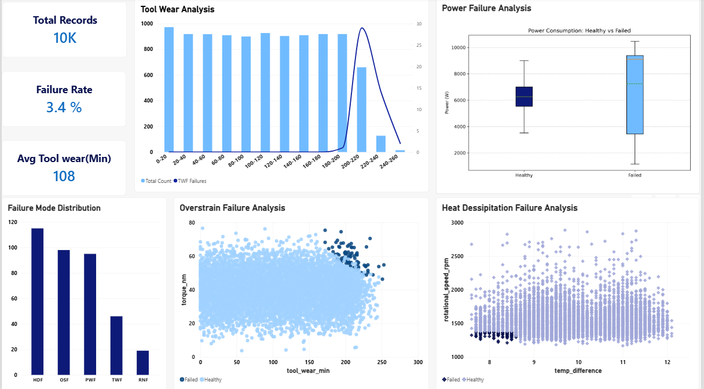

# Machine Failure Analysis and Diagnostics: SQL & Power BI 

**[View SQL Queries](link-to-sql-folder)**

## Business Context
**The Problem:** The production department faced costly unplanned downtime. The Head of Production lacked visibility into the operational health of the machinery and did not know which failure modes were most critical.

**The Goal:** To Analyze 10,000 machine operational records to identify the root causes of failures, establish safe operating parameters, and provide actionable insights to minimize failure rates.

## Dashboard Preview
 

## Key Insights Noted
By analyzing the data, I uncovered the exact operational thresholds for the main failure modes:
1. **Tool Wear Failure (TWF):** Failures do not occur before 180 minutes. The risk spikes drastically between **200–240 minutes**.
2. **Heat Dissipation Failure (HDF):** Occurs almost exclusively when rotational speed drops below **1,380 RPM** combined with a low temperature differential less than **8.6 K**.
3. **Power Failure (PWF):** Occurs at the extremes, not at the middle. Machines fail when power drops below **3,500 Watts** or when it exceeds **9,000 Watts**.
4. **Overstrain Failure (OSF):** Occurs when there is a combination of high tool wear (200+ min) and high torque.

## Tech Stack & Methodology
* **Data Extraction & Transformation:** PostgreSQL
  * Used CTEs (Common Table Expressions) to segment machine states.
  * Used `width_bucket` to create logical ranges for tool wear analysis.
  * Used `UNION ALL` to combine individual failure mode count into one table. 
* **Visualization:** Power BI
  * Built a custom sorting model in Power Query to fix text-based bin sorting.
  * Created a custom boxplot using python script to show power consumption extremes.

##  How to Use
1. Download the dataset from the official source:[Machine Data](https://archives.ics.uci.edu/dataset/601/ai4i+2020+predictive+maintenance+dataset)
2. Run the SQL scripts in your local PostgreSQL environment to recreate the database and views.
3. Open the Power BI file to interact with the dashboard.
